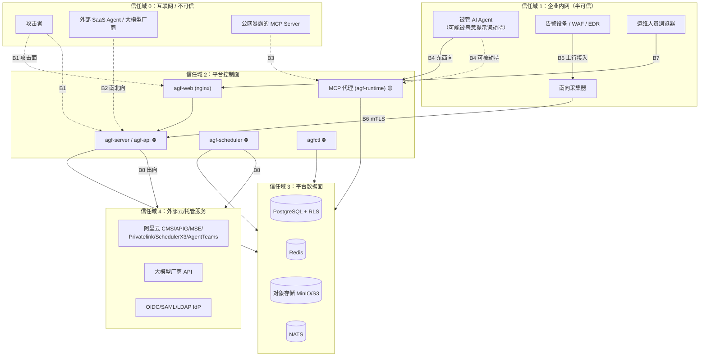

# AIGuardFabric 威胁模型

> **分析对象：平台自身**（不是被管 AI 资产）。被管 AI 资产的风险见 §4「五大 AI 安全域」。
> 事实来源：`crates/agf-core/src/{adapter,auth,audit,secret,redact,config,error}.rs`、
> `crates/agf-storage/src/{crypto,db,redis_store,objectstore,repository}.rs`、
> `crates/agf-auth/src/*`、`crates/agf-aigw/src/{gateway,screen,cache,provider}.rs`、
> `crates/agf-ingest/src/{receiver,pipeline,syslog}.rs`、`crates/agf-runtime/src/*`、
> `crates/agf-alicloud/src/{credential,http,registry}.rs`、
> `deploy/sql/migration_parts/`、`docker-compose*.yml`、`deploy/docker/{Dockerfile,nginx.conf}`。
>
> ⚠️ **实现状态限定**：`agf-api` / `apps/*` / `agf-adapters` / `agf-agent` / `agf-correlate` 为空壳，
> `agf-runtime` 正在修复。因此本文件中**控制目标**（设计应达到）与**控制现状**（代码已验证）分列。
> 状态列含义：🟢 代码已验证 · 🟡 部分实现或正在修复 · 🔴 未实现 · ⚙️ 部署/编排层已配置。
> 缺口编号见 [`docs/pending-verification.docs.md`](pending-verification.docs.md)。

---

## 1. 资产与信任边界

### 1.1 需要保护的资产（按价值降序）

| # | 资产 | 载体 | 泄露/被篡改的后果 |
|---|---|---|---|
| A1 | **平台主密钥**（`AGF_MASTER_KEY_BASE64`，32 字节） | `.env` / 进程内存 / KMS | 可解密**全部租户的全部凭据**（AES-256-GCM 唯一根密钥） |
| A2 | **JWT 签名密钥**（`AGF_JWT_SECRET`，≥32 字节） | `.env` / 进程内存 | 可伪造任意租户/任意用户的访问令牌 |
| A3 | **纳管的外部门凭据**（大模型 API Key、阿里云 AK/SK/STS、设备账号、数据库口令） | `credentials` 表（AES-GCM 密文）+ 内存 `SecretString` | 横向入侵客户云账号与外部系统 |
| A4 | **审计日志链**（`audit_logs` + `audit_chain_anchors`） | PostgreSQL | 攻击者可抹除入侵痕迹；合规失效 |
| A5 | **原始日志与归一化事件**（`raw_logs` / `events`） | PostgreSQL + 对象存储 | 泄露客户业务数据与安全态势 |
| A6 | **案件与取证证据包** | 对象存储（`agf-evidence` 桶） | 证据链失效 |
| A7 | **策略与规则包**（`policies` / `risk_rules` / `rule_versions`） | PostgreSQL + `rules/` 目录 | 攻击者可关闭检测或放开拦截 |
| A8 | **资产台账与拓扑**（`assets` / `asset_relations`） | PostgreSQL | 泄露企业 AI 资产全景（攻击前置情报） |
| A9 | **终端采集器 mTLS 私钥** | 终端文件系统 / `AGF_COLLECTOR_KEY` | 可伪造采集器上行数据 |
| A10 | **租户隔离不变量**（RLS + `agf.tenant_id`） | PostgreSQL | 跨租户数据泄露（SaaS 场景致命） |
| A11 | **配额与计费数据**（`quotas` / `quota_usage` / `usage_records`） | PostgreSQL + Redis | 计费失真、配额绕过 |

### 1.2 信任边界



| 边界 | 两侧 | 控制手段 | 状态 |
|---|---|---|---|
| **B1** 公网 ↔ 控制台/API | 信任域 0 ↔ 2 | 前置 Ingress/SLB 做 TLS 终结；nginx 安全头 + CSP；JWT/API Key 认证；三级限流；`Idempotency-Key` | ⚙️ nginx 已配 · 🟢 API 已实现（认证 / 三级限流 / `Idempotency-Key` 均已接线） |
| **B2** 平台 ↔ 外部 SaaS Agent / 大模型厂商 | 0 ↔ 2/4 | 出向白名单；内容预筛（`screen`）；数据分级门禁（`Restricted` 强制本地部署）；凭据仅在服务端 | 🟢 `screen` + `router` · 🔴 出向白名单仍未实现（API 层已就绪） |
| **B3** MCP 代理 ↔ 公网 MCP Server | 0 ↔ 2 | 域名出网管控（`blocklist`）；工具白名单；策略引擎 | 🟡 `agf-runtime` 修复中 |
| **B4** MCP 代理 ↔ 被管 Agent（**东西向，最危险的边界**） | 1 ↔ 2 | 代理进程由平台侧持有；策略签名校验；三级配额；拦截审计；**不信任 Agent 上报的任何内容**（一律过检测） | 🟡 `agf-runtime` 修复中 |
| **B5** 告警设备 ↔ 采集器 | 1 ↔ 1 | 设备侧账号最小权限；只读拉取 | 🟢 `agf-adapters` **12 个适配器全部有真实传输**（通知/建单/EDR 隔离/SCIM 停用/Syslog 转发/`email` SMTP），**设备侧 `sync`/`pull` 已对支持的协议实现**（`edr` 的主机清单 + 设备事件增量拉取与对账；工单类 `jira`/`servicenow`/`zentao` 同样支持）——其余无读取语义的设备事件仍经 Syslog/Webhook 转发进 `agf-ingest`（见 `crates/agf-adapters/CAPABILITY-MATRIX.md`） |
| **B6** 采集器 ↔ 接入服务 | 1 ↔ 2 | **mTLS**（`AGF_COLLECTOR_MTLS_CA/CERT/KEY`）+ 证书指纹纯函数校验（`CollectorUplinkAuth`）+ `require_mtls` + `allowed_cidrs`；客户侧**零入向端口**（主动出网） | 🟢 校验逻辑（`agf-ingest/src/receiver.rs`）· 🟢 客户端（`agf-agent` 采集器已实现：采集清单/上报协议/客户端/本地队列/自更新）；**真实 mTLS 证书与网络联调属阶段二（PV-005）** |
| **B7** 运维浏览器 ↔ 控制台 | 1 ↔ 2 | 登录门禁（前端 `RequireAuth` 只判 token 存在）；令牌存 localStorage；**服务端必须做真正的鉴权** | 🟢 前端 · 🟢 服务端（`agf-api` 的 `Principal` 逐请求 RBAC/ABAC，401/403 不被演示降级掩盖） |
| **B8** 平台 ↔ 阿里云/大模型厂商 | 2 ↔ 4 | 单一网络闸门 `http::RpcClient::live`（Mock 模式或缺 AK/SK 时返回错误）；RAM Role/STS 优先；调用纳入审计与限流 | 🟢 闸门 + 凭据优先级 · 🔴 真实 STS 未实现 |
| **B9** 平台 ↔ 数据面 | 2 ↔ 3 | RLS + `agf.tenant_id`；字段加密 AAD 绑定；Redis 键租户前缀；对象存储 `validate_key` 防路径穿越 | 🟢 全部已验证 |
| **B10** 平台 ↔ IdP | 2 ↔ 4 | OIDC PKCE / SAML / LDAP；`idp_configs` 表 | 🔴 真实联调属阶段二 |

### 1.3 攻击者画像

| 画像 | 能力 | 主要目标 | 主要路径 |
|---|---|---|---|
| **外部未认证攻击者** | 网络可达控制台/API | A2/A5（伪造令牌、拖数据） | B1 |
| **被劫持的被管 Agent**（提示词注入后） | 能在其权限内发 MCP 调用与模型请求 | A3（偷凭据）、A7（关检测）、绕过拦截 | B4 |
| **恶意内部人员（低权限运维）** | 有控制台受限账号 | A4（抹痕迹）、A10（跨租户） | B1/B7 |
| **恶意租户（SaaS 多租户）** | 完全控制自己租户的配置与数据 | A10（越权读他人租户） | B9 |
| **供应链攻击者** | 能污染依赖/镜像/规则包 | 全平台 | 构建链、`rules/` |
| **云侧被攻陷** | 控制客户的阿里云账号/大模型账号 | A3/A8 | B8 |
| **恶意 MCP Server / RAG 文档** | 能返回带指令的内容 | 操纵 Agent 行为 | B3/B4 |

---

## 2. STRIDE 逐项分析（针对平台自身）

### 2.1 控制台（`agf-web` / nginx）

| STRIDE | 威胁 | 控制措施 | 状态 | 证据 |
|---|---|---|---|---|
| **S**poofing | 伪造运维身份登录控制台 | Argon2id 口令校验 + TOTP MFA + API Key（`X-AGF-Key`） | 🟢 库层 | `agf-auth/src/{password,mfa,api_key}.rs` |
| **S**poofing | 会话劫持（localStorage 中的 JWT 被 XSS 窃取） | nginx `CSP: default-src 'self'; script-src 'self'; object-src 'none'`；`X-Content-Type-Options: nosniff` | ⚙️ 已配 | `deploy/docker/nginx.conf:21-26` |
| **S**poofing | 点击劫持 | `X-Frame-Options: DENY` + `frame-ancestors 'none'` | ⚙️ 已配 | `nginx.conf:22,26` |
| **T**ampering | 篡改前端产物 | 带 hash 的产物 + `Cache-Control: public, immutable`（1 年）；`index.html` `no-store` | ⚙️ 已配 | `nginx.conf:29-37` |
| **T**ampering | 通过 CDN/第三方脚本注入 | CSP `default-src 'self'`，无外部脚本源；前端无埋点 SDK | ⚙️ + 🟢 | `nginx.conf:26`、`apps/web/package.json` |
| **R**epudiation | 否认执行过某操作 | 所有写操作应记 `audit_logs`（哈希链） | 🟢 库层 | `AuditRepo::append` |
| **I**nformation disclosure | 版本号泄露 | `server_tokens off` | ⚙️ 已配 | `nginx.conf:18` |
| **I**nformation disclosure | 前端演示数据被误认为真实数据 | `DemoModeBanner`（顶栏常驻 + 用户菜单只读状态项 + 头像 Badge） | 🟢 | `apps/web/src/components/DemoModeBanner.tsx` |
| **D**oS | 前端资源被刷 | nginx 无应用层限流（限流在 API 层） | 🔴 | — |
| **E**levation | 前端绕过登录门禁直接进内页 | `RequireAuth` 只判 token 存在（**不做角色与有效性校验**）⇒ **必须由服务端强制鉴权**，前端门禁只是 UX | 🟡 前端已实现 · 🟢 服务端已强制鉴权（`Principal` 逐请求 RBAC/ABAC，见 §2.2） | `apps/web/src/app/router.tsx:41-50` |

> **重要结论**：前端登录门禁 `RequireAuth` 的判定只有 `useAuthStore(state => state.token)` 是否为真，
> **不校验角色、不探测 token 有效性**。因此"绕过前端门禁"是零成本攻击；所有真实授权必须在 `agf-api` 完成。

### 2.2 API（`agf-api` / `agf-server`）🟢 已实现

| STRIDE | 威胁 | 应实施的控制 | 现状 |
|---|---|---|---|
| **S**poofing | 伪造 JWT | `TokenIssuer::verify`（含 `iss`/`exp` 校验、HS256）、刷新令牌指纹（`refresh_fingerprint`，SHA-256 + salt） | 🟢 库层（`agf-auth/src/claims.rs`） |
| **S**poofing | 令牌重放 | 刷新令牌轮换 + 撤销表（`refresh_tokens.user_id, revoked` 索引）；`RevokedToken` 模型 | 🟢 库层 · 🟢 API 已接（`POST /api/v1/auth/refresh` 轮换并吊销旧令牌、`/auth/logout` 撤销） |
| **S**poofing | 暴力破解口令 | 登录失败锁定（默认 5 次 / 900 秒）+ `login_attempts` 表 + `AuthError::public_message()` 防用户名枚举 | 🟢 库层 | 
| **T**ampering | 请求参数被改 | 输入校验（`DomainError::Validation`）；幂等键 `Idempotency-Key` | 🟢 错误模型 · 🟢 API 已接（幂等中间件复用首次响应并回 `Idempotency-Replayed: true`） |
| **T**ampering | SQL 注入（动态表名） | `is_safe_identifier()` 白名单校验所有拼接的表名/列名 | 🟢 | `agf-storage/src/db.rs:403` |
| **T**ampering | 乐观锁绕过（并发覆盖） | `TenantTransaction::optimistic_update(table, id, expected_version, …)` | 🟢 | `db.rs:358` |
| **R**epudiation | 高危操作无留痕 | 每次写操作应落 `audit_logs`（哈希链） | 🟢 库层 · 🟢 API 已接（`ApiStore::persist_audit` → `AuditRepo`，哈希链可整体回读） |
| **I**nformation disclosure | 跨租户读取 | 三层隔离（RLS + `agf.tenant_id` + `assert_owned`） | 🟢 | 见 §3 |
| **I**nformation disclosure | 错误信息泄露内部细节 | `DomainError` → RFC 9457 problem+json，`code` 为稳定机器码；`AuthError::public_message()` 输出通用文案；`Debug` 打码 | 🟢 模型 · 🟢 已实现（`agf-api/src/error.rs` 输出 `application/problem+json`） |
| **I**nformation disclosure | 分页拖库 | 分页上限 + 字段裁剪 + 三级限流（`X-RateLimit-*`） | 🟢 `Pagination` 模型 · 🟢 限流已接（`middleware::rate_limit` 回 `X-RateLimit-*` 头） |
| **D**oS | 单租户刷爆 API | Redis 固定窗口限流 `RedisStore::rate_limit`；`AGF_QUOTA_TENANT_REQ_PER_MIN`（默认 6000）；`fail_closed` 语义 | 🟢 库层 · 🟢 API 已接（`middleware::rate_limit` + `agf_rate_limited_total`） |
| **D**oS | 大体积请求 | `ServerConfig::max_body_bytes` 默认 16 MiB；nginx `client_max_body_size 32m` | 🟢 + ⚙️ |
| **D**oS | 慢连接耗尽连接池 | SQLx `acquire_timeout`（`AGF_PG_CONNECT_TIMEOUT_SECS` 默认 10s）；`idle_timeout` 600s；`max_lifetime` 1800s；`test_before_acquire(true)` | 🟢 | `db.rs:59-66` |
| **E**levation | 越权调用管理接口 | RBAC（角色→权限点）+ ABAC（部门/数据分级/来源网段 `cidr_matches_any`） | 🟢 库层 · 🟢 API 已接（`middleware.rs` 的 `Principal` 逐请求判定，`/graphql` 复用同一路径） |
| **E**levation | 租户内权限提升 | `Authorizer::overprivileged_roles()` 可检出过度授权角色 | 🟢 库层 |

### 2.3 MCP 代理（`agf-runtime`）🟡 修复中

| STRIDE | 威胁 | 应实施的控制 | 现状 |
|---|---|---|---|
| **S**poofing | 恶意进程冒充被管 Agent 连接代理 | 代理侧鉴权（会话令牌/进程绑定） | 🟡 见源码 |
| **S**poofing | 冒充上游 MCP Server | 上游 TLS 校验；域名白名单 | 🟡 `blocklist` 含域名出网管控 |
| **T**ampering | 中间人改写工具调用参数 | 双向代理全程在平台侧；`redact` 双向脱敏 | 🟡 `mcp_proxy` + `agf-core/src/redact.rs` |
| **T**ampering | 篡改本地策略文件使拦截失效 | **策略签名校验**（`signature.rs`） | 🟡 见源码 |
| **R**epudiation | 否认发起过危险工具调用 | 拦截审计落 `policy_hits` + `audit_logs` | 🟢 `PolicyRepo::record_hit` |
| **I**nformation disclosure | 工具返回内容夹带凭据回传给 Agent | 响应侧脱敏（`redact`） | 🟢 `redact.rs`（含占位符还原） |
| **D**oS | 单 Agent 高频调用打爆上游 | 三级配额（租户→Agent→会话）× 四维度 | 🟢 `agf-runtime/src/quota.rs` + Redis Lua |
| **D**oS | 单个巨型工具结果撑爆内存 | 请求/响应大小上限（`max_body_bytes` 等） | 🟡 见源码 |
| **E**levation | **被管 Agent 主动关闭代理** | 见 §5.1 防绕过设计 | 🟡 属部署属性 |
| **E**levation | 越权调用未授权工具 | 工具白名单 + 策略 `allow/deny` | 🟢 `blocklist` + `policy` |
| **E**levation | 命令注入/路径穿越经工具参数到达宿主 | 命令级黑名单（`rm -rf`、`curl \| sh`、高危域名） | 🟢 `blocklist.rs` |

### 2.4 AI 网关（`agf-aigw`）🟢 已实现

| STRIDE | 威胁 | 控制措施 | 证据 |
|---|---|---|---|
| **S**poofing | 冒充上游厂商（DNS 劫持/中间人） | 全部出向用 `rustls`（`reqwest` `rustls-tls-native-roots`）；Bedrock 请求自签 SigV4 | `Cargo.toml:115-124`、`provider.rs::sign_sigv4` |
| **S**poofing | 伪造端点凭据 | `CredentialResolver`（`EnvCredentialResolver` / `StaticCredentialResolver` / `MockCredentialResolver`）；`credential_ref` 指向加密的 `credentials` 表 | `provider.rs` |
| **T**ampering | 篡改缓存内容造成错误回答 | 缓存键 = `SHA-256(规范化请求)` 精确指纹（`ChatRequest::fingerprint()`）；**刻意排除 `metadata`/`user`/`stream`/`max_tokens`** | `wire.rs:504-543` |
| **T**ampering | 篡改计量数据 | `Meter` 为进程内 `Arc<Mutex<..>>`；⚠️ **无落库消费者，重启即丢失** | `meter.rs`（见残留风险 R6） |
| **R**epudiation | 否认调用过某模型 | `GatewayResponse.usage_record` 可落 `usage_records` 表 | 🟡 模型就绪 · 🔴 无落库方 |
| **I**nformation disclosure | 敏感数据发给云端模型 | ① `RoutingContext.data_class` 门禁：端点 `accepts_data_class()` 为假即排除，**`Restricted` 强制 `local_deployment == true`**；② `screen_request` 预筛；③ `metadata.data_class` 提示 | `router.rs:321-351`、`gateway.rs:549-577` |
| **I**nformation disclosure | 凭据出现在请求/响应中 | `KeywordScreen` 的 `credential_action = Redact`（默认）：凭证外传类模式命中则**改写请求**为占位符 | `screen.rs:315,464,601` |
| **I**nformation disclosure | 缓存跨租户串号 | 缓存键含租户：`aigw:cache:{tenant}:{fingerprint}` | `cache.rs:218` |
| **I**nformation disclosure | 提示词/响应泄露到日志 | `raw_excerpt` 类型设计上截断；`AppConfig` Debug 打码 | `risk.rs::LlmJudgement` |
| **D**oS | 成本爆炸（Token 洪水） | `BudgetGuard::ensure_within_budget`（`max_single_micro` / `max_total_micro`）→ `QuotaExceeded`，**调用前拒绝，不产生上游费用**；`Meter` 多维度聚合 | `meter.rs:336-425` |
| **D**oS | 上游不可用拖垮网关 | 熔断（`CircuitBreakerConfig`：默认阈值 5 / 开路 30s / 半开 1 探测器）+ 指数退避重试（默认 3 次，上限 10s，带抖动）+ 降级链 | `agf-core/src/adapter.rs:696-737` |
| **D**oS | 缓存被恶意填满 | 容量上限 `DEFAULT_CAPACITY = 512` + TTL 900 秒；`is_cacheable` 拒绝不安全的请求 | `cache.rs:42-45,142-160` |
| **E**levation | 越权使用高价模型 | 路由 `pinned_model` + `priority` + 租户过滤（端点租户不匹配即排除） | `router.rs:321-351` |
| **E**levation | 通过 prompt 让模型输出凭据 | `screen_response` 后置过滤：命中则 `Redact` 或 `Block`（`Block` 时用 `safe_response_text(rule_id)` 替换正文） | `gateway.rs:668,881-896` |
| **E**levation | 豁免缓存底线 | 三条**不可豁免**规则：含 `side_effecting` 工具 ❌、数据分级不被端点接受 ❌、预筛 `Redact`/`Block` 不受 `allow_cache` 影响 | `cache.rs:142-160` |

**内容预筛的精确覆盖（20 条关键词模式）**：

| 类别 | 条数 | 默认动作 | 示例模式 |
|---|---|---|---|
| 越狱 / 角色劫持 | 10 | **Block** | `ignore previous instructions`、`忽略之前的所有指令`、`you are now dan`、`developer mode` |
| 系统提示词泄露 | 6 | **Block** | `system prompt`、`系统提示词`、`print your initial prompt` |
| 凭证外传 | 4 | **Redact** | `send the api key to`、`upload your credentials`、`curl http` |

> **预筛的局限（重要）**：`KeywordScreen` 只做**关键词/子串匹配**（先 `to_lowercase`）。
> 它不能识别语义级越狱、编码绕过、多轮渐进诱导。`agf-scan` 的规则引擎**尚未接入 `ContentScreen`**
> （`ContentScreen` 被设计为未来插入点，当前唯一实现是 `KeywordScreen` / `CompositeScreen` / `NoopScreen`）。

### 2.5 采集器上行（`agf-ingest` receiver）🟢 校验逻辑已实现

| STRIDE | 威胁 | 控制措施 | 证据 |
|---|---|---|---|
| **S**poofing | 伪造采集器上报假数据 | **mTLS 证书指纹纯函数校验**（`CollectorUplinkAuth`）+ `LogSource::require_mtls` + `allowed_cidrs` | `receiver.rs`、`agf-core/src/source.rs` |
| **S**poofing | 重放合法采集器报文 | `RawLog.payload_hash`（去重索引 `ix_raw_logs_hash`）+ 事件 `dedup_key`（源+时间+原始载荷哈希） | `0001_init_03.sql:136`、`event.rs::dedup_key` |
| **T**ampering | 篡改上行载荷 | mTLS 提供传输完整性与机密性（客户端主动出网） | `receiver.rs` |
| **T**ampering | 解析器被诱导解析出错误字段 | 模板正负样本回归（`SampleRegression`）+ `sample_match_score` 阈值 0.5；原始载荷保真落库可复算 | `agf-scan/src/samples.rs`、`engine.rs:59` |
| **R**epudiation | 否认上报过某日志 | `raw_logs` 保真存储 + `payload_hash` + `raw_hash` | `normalize.rs` |
| **I**nformation disclosure | 上行内容含凭据 | `pipeline::redact_event`（默认 `CredentialsOnly`）+ 归一化前/后均可脱敏 | `pipeline.rs:840` |
| **I**nformation disclosure | Webhook 令牌被盗用 | Bearer 鉴权用**常量时间比较**（`constant_time_eq`）防时序侧信道 | `receiver.rs` |
| **D**oS | 单源洪泛打爆接入 | `LogSource::max_eps`；`IngestConfig::batch_limit`（默认 512）；有界内存总线（`InMemoryEventBus::dropped()` 计数） | `source.rs`、`pipeline.rs:390-404`、`bus.rs` |
| **D**oS | Syslog UDP 放大/伪造 | UDP 无认证（协议固有）；`allowed_cidrs` 可限制来源 | `agf-core/src/source.rs` |
| **E**levation | 通过上行数据触发平台侧动作 | 接收器只做解析入队，**不做执行**；风险判定与动作由 `agf-scan` / `agf-runtime` 决定 | `receiver.rs` / `pipeline.rs` |

> **Syslog 的固有风险**：`SyslogTcpListener` / `SyslogUdpListener` 本身**不做鉴权**；
> TLS（RFC5425）**已实现**（`SyslogTlsListener`，`AGF_SYSLOG_TLS_PORT` 默认 6514，`CERT`/`KEY` 配齐才监听；原 `TODO ingest-syslog-tls` 锚点已随实现移除），生产可只启用 TLS 端口。
> 端口 5514 若暴露到不可信网络，攻击者可注入伪造日志。**缓解：只在内网暴露，并用 `allowed_cidrs` 限制。**

### 2.6 云适配器（`agf-alicloud`）🟢 Mock 完整，真实 STS 未实现

| STRIDE | 威胁 | 控制措施 | 证据 |
|---|---|---|---|
| **S**poofing | 凭据被替换为攻击者的 AK | 凭据经 `credentials` 表密文存储 + `secret_refs` 引用；`AdapterConfig` 只放非敏感 `settings` | `adapter.rs:72-113` |
| **S**poofing | 中间人攻击云 API | PrivateLink 私网 endpoint（`endpoint.rs` 支持 `*.privatelink.aliyuncs.com`）；HTTPS 签名 | `endpoint.rs:327` |
| **T**ampering | 响应被篡改 | V3（ACS3-HMAC-SHA256）与 RPC（HMAC-SHA1）签名 | `signer.rs` |
| **R**epudiation | 否认下发过策略 | 调用纳入审计与限流；`deadletter` 记录失败载荷与尝试次数 | `deadletter.rs` |
| **I**nformation disclosure | 长期 AK 明文落盘 | **凭据优先级：RAM Role / STS > 临时凭据 > 长期 AK**；长期 AK 使用会登记风险（`credential.rs`）。`.env.example:213` 明确"禁止长期 AK 明文落盘（用 `agfctl secret set` 写库）" | `credential.rs` |
| **I**nformation disclosure | Mock 模式误发真实请求导致凭据外泄 | **单一网络闸门**：所有真实调用必须先过 `http::RpcClient::live`，该函数在 `AdapterMode::Mocked` 或缺 AK/SK 时返回错误 ⇒ **不存在"忘了判断 mock 就打网络"的路径** | `agf-alicloud/src/lib.rs:10-13` |
| **D**oS | 云 API 限流/欠费 | 熔断 + 重试 + 死信隔离（连续失败进 `dead_letters` 表，不阻塞主流程） | `adapter.rs`、`deadletter.rs` |
| **D**oS | 云侧宕机拖垮平台 | 未配置/断网 = **降级而非错误**：`init` 永远返回 `Ok(())`，`health` 暴露 `Unconfigured`，由 `Mock*Adapter` 接管 | `registry.rs:562-574`（测试 `from_configs_without_credentials_degrades_not_fails`） |
| **E**levation | 权限过宽（最小权限失败） | `self_check` 输出**最小权限 RAM 策略 JSON**（`ram_policy_json()`，只含必需权限，不含可选权限） | `selfcheck.rs`、`registry.rs:603-608` |
| **E**levation | 跨账号 AssumeRole 被滥用 | `AGF_ALIYUN_ASSUME_ROLE_ARN` + `ROLE_SESSION_NAME`；⚠️ **真实 AssumeRole 未实现**（返回 `NotImplemented`） | `credential.rs:550` |

### 2.7 数据库与对象存储（`agf-storage`）🟢 已验证

| STRIDE | 威胁 | 控制措施 | 证据 |
|---|---|---|---|
| **S**poofing | 冒充应用连接数据库 | `password_encryption=scram-sha-256`（compose 命令参数）；生产 `PgSslMode::VerifyFull` | `docker-compose.yml:97`、`db.rs:51` |
| **S**poofing | Redis 未授权访问 | ⚠️ compose 的 redis 命令**未设置 `requirepass`**；依赖网络隔离 | `docker-compose.yml:116-125`（见残留风险 R4） |
| **T**ampering | 改密文（凭据被替换） | AES-256-GCM 认证标签；翻转密文任何一位都解密失败 | `crypto.rs`（测试 `tampered_ciphertext_is_rejected`） |
| **T**ampering | **密文搬家**（把 A 租户密文复制到 B 租户记录） | **AAD = `tenant:<租户>\|id:<记录 id>`** | `crypto.rs:98-100`（测试 `aad_mismatch_fails_authentication`） |
| **T**ampering | 篡改审计日志 | 哈希链 + 锚点 HMAC 签名；`verify_chain` 检出 `prev_gap` | `agf-core/src/audit.rs` |
| **T**ampering | 对象键路径穿越写入 | `validate_key()`：禁绝对路径、禁 `..`、禁空段、禁 NUL、长度 ≤1024 | `objectstore.rs:114-130` |
| **T**ampering | 软删除数据被恢复/绕过 | `purge_soft_deleted(table, older_than_days)` 需显式调用；所有查询应带 `deleted_at IS NULL`（索引已按此建） | `db.rs:228`、`0001_init_01.sql:278-279` |
| **R**epudiation | 否认跨租户访问 | `TenantTransaction::assert_owned` 把越权从静默 404 提升为**显式 `DomainError::TenantViolation`**（可审计） | `db.rs:328-352` |
| **I**nformation disclosure | 跨租户读取（SaaS 致命） | 三层隔离，见 §3 | `0001_init_04.sql:241-275`、`db.rs:129` |
| **I**nformation disclosure | 备份/日志含明文凭据 | `AppConfig`/`FieldCipher` 的 Debug 打码；SQLx `log_statements(Debug)` **不打印绑定参数** | `config.rs:671-695`、`db.rs:55-57` |
| **I**nformation disclosure | 对象存储桶公开 | `minio-init` 显式 `mc anonymous set none agf/<bucket>` | `docker-compose.yml:222` |
| **D**oS | 连接池耗尽 | `pool_max`（默认 20，prod 50）+ `acquire_timeout` + `test_before_acquire(false)` 的取舍 | `db.rs:59-66` |
| **D**oS | Redis 内存爆 | `--maxmemory 512mb --maxmemory-policy allkeys-lru` | `docker-compose.yml:122-125` |
| **D**oS | 磁盘写满（表无限增长） | `retention_plan(hot_days=30, cold_days=365)`；软删除清理；TimescaleDB 按天分区 DETACH | `coldarchive.rs:128` |
| **E**levation | 超级用户改数据绕过 RLS | `agf_platform_admin NOLOGIN BYPASSRLS`（**NOLOGIN**，应用不使用） | `0001_init_04.sql:277-286` |
| **E**levation | 平台级事务误读租户表 | `begin_platform()` 下访问 RLS 表**返回空集**（有意为之的安全默认值） | `db.rs:140-149` |

#### 时序侧信道：密钥标识回显

`FieldCipher::decrypt` 在 `key_id` 不匹配时返回的文案包含**两个密钥标识**（密文的与当前的）：

```rust
// crates/agf-storage/src/crypto.rs:138-143
if material.key_id != self.key_id {
    return Err(DomainError::Crypto(format!(
        "密文由密钥 {} 加密，当前密钥为 {}，请先执行密钥轮换解密",
        material.key_id, self.key_id
    )));
}
```

**评估**：该文案只用于运维排障（密钥轮换），泄露的是**密钥版本标识**（如 `v1` / `v2`），不是密钥本体。
`key_id` 同时以明文存于 `SecretMaterial` 中，因此不是新增泄露面。**残余风险：可接受**（见 R7）。

---

## 3. 多租户隔离的失效模式分析

租户隔离是 SaaS 场景的**单点致命风险**，因此单独做失效模式分析。

| 失效模式 | 后果 | 已实施的防护 | 状态 |
|---|---|---|---|
| 忘记设置 `agf.tenant_id` | RLS 策略 `tenant_id = NULL` 恒为假 → **返回空集**（安全侧失败） | `agf_current_tenant()` 返回 `NULL`；`begin_platform()` 文档明确说明该行为 | 🟢 |
| 连接复用导致租户串号 | 读到上一个租户的数据 | `SET LOCAL`（事务级）而非 `SET`；事务结束自动清理；`Store::with_tenant` 封装 | 🟢 |
| 应用层 `WHERE` 漏写租户条件 | 越权返回数据 | RLS 作为数据库层兜底；**不依赖应用层 WHERE** | 🟢 |
| 拼表名造成 SQL 注入绕过 RLS | 任意数据读取 | `is_safe_identifier()` 白名单（ASCII 字母数字下划线、≤63 字符、不以数字开头） | 🟢 |
| `WITH CHECK` 缺失导致跨租户写入 | 往他人租户插数据 | 策略同时含 `USING` 与 `WITH CHECK` | 🟢 |
| `events` 表未启用 RLS（复合主键，无 tenant_id 外键） | 全租户事件互相可见 | `events` **单独配置** RLS 策略（`0001_init_04.sql:267-275`，`EXCEPTION` 捕获失败仅 NOTICE） | 🟢 |
| RLS 策略被后续迁移误删 | 静默失效 | `DROP POLICY IF EXISTS` + `CREATE POLICY`（幂等重建）；`Database::server_info()` 返回 `rls_enabled_tables` 计数可用于巡检 | 🟢 |
| Redis 多租户串号 | 配额/缓存互相影响 | 键前缀 = `AGF_REDIS_PREFIX`（默认 `agf`）+ 键内含 `tenant` 段，如 `agf:quota:{tenant}:{scope}:{dimension}:{bucket}` | 🟢 |
| 对象存储桶共享导致串号 | 跨租户读证据包 | ⚠️ **对象键中不含租户前缀**（`archive_key` 模板为 `agf-events/dt=.../hour=.../events-<uuid>-<seq>.ndjson.gz`）。当前依赖桶级隔离与 API 层鉴权 | 🔴 见 R3 |
| 网关端点跨租户使用 | 用他人端点与凭据 | `ModelRouter::exclude_reason` 过滤租户不匹配的端点（保留全局端点） | 🟢 |
| 备份恢复把 A 租户数据带进 B 租户 | 数据错配 | 备份为整库 `pg_dump`，恢复同样是整库（不按租户拆分） | 🟡 设计如此 |

**隔离强度分级**：

| 级别 | 实现 | 状态 |
|---|---|---|
| 逻辑隔离 | RLS（50 张表）+ `agf.tenant_id` + 应用校验 + Redis 前缀 | 🟢 |
| 物理隔离 | `AGF_TENANT_PHYSICAL_ISOLATION=0`（默认关）；`tenants.isolation` 字段与 `tenant_settings` 表已预留 | 🔴 独立库/独立 schema 未落地 |

---

## 4. 五大 AI 安全域的攻击面与检测手段映射

### 4.1 规则包结构（`rules/` 目录）

| 事实 | 说明 |
|---|---|
| 目录 | `AGF_RULES_DIR=<项目根>/rules`（`.env.example:315`）；容器内 `/app/rules`（只读挂载） |
| 文件格式 | 递归扫描，**只取 `*.yaml` / `*.yml`**，其它扩展名忽略；每个文件是**单个** `RuleDefinition`（不是数组/多文档） |
| 目录约定 | 约定路径形如 `<rules_dir>/<domain>/*.yaml`，`<domain>` 取 `RiskDomain::as_str()` 的五个域码；**但代码只从 YAML 的 `domain:` 字段取域，路径不参与解析**（"目录名即域"是规范而非强制） |
| 灰度 | `RuleDefinition::applies_to_asset(&Id)`：`enabled=false` → 不生效；`rollout_percent >= 100` → 全量；`== 0` → 不生效；否则 `content_hash(asset_id)` 首字节 % 100 < 百分比 |
| 版本化 | `RuleVersion` + `RuleVersionState`（`draft` / `canary` / `published` / `retired`）；`samples_green()` 是发布前置条件 |
| 包指纹 | `pack_fingerprint = content_hash(sorted(规则 content_hash).join("\n"))`；规则哈希只覆盖 key/name/domain/severity/kind/target/action/detection（不含 `samples`） |
| 加载期强制 | `RuleDefinition::validate()`：key/name 非空、**`samples.is_complete()`（≥1 正 ≥1 负）**、`rollout_percent <= 100`、递归预编译全部正则 |
| **当前状态** | ✅ `rules/` 下**已有 54 条 YAML**（覆盖 prompt-attack / credential-leak / rag-poison / tool-abuse / model-data 五个域目录），`agfctl rules verify` 实测 **54/54 规则、正样本 111/111、负样本 113/113**（规格 §11 验收 7 已达成） |

**规则 YAML 字段全集**（`agf-core/src/rule.rs`）：

| 字段 | 必填 | 说明 |
|---|---|---|
| `key` / `name` | ✅ | 规则键（如 `PA-INJ-001`）与名称 |
| `domain` | ✅ | 五域之一：`prompt-attack` / `credential-leak` / `rag-poison` / `tool-abuse` / `model-data` |
| `severity` | ✅ | `info` / `low` / `medium` / `high` / `critical` |
| `kind` | ✅ | `regex` / `keyword` / `semantic` / `ast` / `yara` / `entropy` / `composite` |
| `target` | ✅ | 11 值：`prompt` / `model-output` / `tool-arguments` / `tool-result` / `mcp-request` / `mcp-response` / `event-payload` / `document` / `config` / `file-content` / `tool-definition` |
| `action` | ✅ | `PolicyAction` 10 值（含 `allow`/`deny`/`audit`/`quota`/`redact` 等） |
| `detection` | ✅ | 判别联合（`type:` 字段），**12 个变体**：`regex` / `keyword` / `keyword-all` / `entropy` / `encoding-bypass` / `ast` / `yara` / `semantic` / `all` / `any` / `not` / `threshold` |
| `samples.positive` / `samples.negative` | ✅（validate 强制） | 正负样本；加载期无样本的规则被丢弃并记入 `missing_samples` |
| `enabled` / `rollout_percent` / `tags` / `references` / `remediation` / `author` / `version` | 可选 | 默认 `true` / `100` / `[]` / `[]` / `""` / `""` / `1` |

### 4.2 五大域 × 攻击面 × 检测手段

| # | 安全域 | 域码 | 攻击面 | `agf-scan` 检测器与检查项 | 状态 |
|---|---|---|---|---|---|
| 1 | **提示词攻击** | `prompt-attack` | 用户提示词、RAG 文档、Agent 间消息、系统提示词 | `DomainDetector::prompt_attack`。checks：`direct-injection` / `indirect-injection` / `jailbreak` / `role-hijack` / `system-prompt-leak` / `encoding-bypass` / `multi-turn-induction`。关键判定：`detect_encoding_bypass`（Base64/Hex/URL/Unicode 转义解码后复检）、`count_invisible`（零宽/不可见字符）、`has_homoglyph`（同形字） | 🟢 |
| 2 | **凭证泄露** | `credential-leak` | Prompt、日志、工具参数、知识库、模型输出 | `DomainDetector::credential_leak`。checks：`api-key` / `cloud-aksk` / `jwt-and-token` / `private-key` / `connection-string` / `kv-assignment`。复用 `agf_core::secret::scan_credentials`（内置模式表），**同一模式跨来源只报一次**；另有独立原语 `shannon_entropy` + `highest_entropy_token` + `looks_like_secret` 检出**未知形态**的高熵凭据 | 🟢 |
| 3 | **RAG 投毒** | `rag-poison` | 知识库文档、向量库、检索上下文 | `DomainDetector::rag_poison`。checks：`instruction-in-document`（Critical）/ `hidden-instruction`（不可见字符计数 > 0，或隐藏样式/HTML 注释 6 种模式）/ `context-conflict`（5 组矛盾词对，`detect_context_conflict`）/ `retrieval-scope`（密级词越权） | 🟢 |
| 4 | **工具与权限滥用** | `tool-abuse` | MCP 工具调用参数、Skill、命令执行、出网 | `DomainDetector::tool_abuse`。checks：`destructive-command`（10 模式）/ `command-injection`（`curl \| sh`、`-o- \|`、`Invoke-Expression`）/ `path-traversal`（`../` 与 `%2e%2e`，反斜杠先归一化）/ `sensitive-file`（14 条敏感路径）/ `ssrf`（内网/环回/云元数据地址）/ `capability-combination`（`ToolTraits::is_rce_capable()` / `is_exfil_capable()`）/ `overbroad-scope` | 🟢 |
| 5 | **模型与数据安全** | `model-data` | 模型输出、数据分级、供应链 | `DomainDetector::model_data`。checks：`credential-in-output`（Critical）/ `pii-echo`（3 条正则，证据强制 `mask_default`）/ `exfil-url`（Markdown 图片链接 + 收集器域名表 `webhook.site`/`requestbin`/`pipedream`/`ngrok`/`burpcollaborator`/`interact.sh`/`oast`，或超长 query）/ `data-class-mismatch`（仅当 `data_class >= Confidential`）/ `supply-chain`（6 模式） | 🟢 |

**综合风险评分**：`aggregate_risk_score` = 按严重等级权重（`Critical 40` / `High 25` / `Medium 12` / `Low 5` / `Info 0`）× 置信度累加，封顶 100。

**置信度模型**：`hit_confidence = clamp(base + min(spans×0.03, 0.15) + severity_bonus − 0.15×degraded, 0.05, 0.99)`；
`base_confidence` 排序：`Yara 0.85` > `Regex 0.80` > `Composite 0.75` > `Ast 0.70` > `Keyword 0.65` > `Semantic 0.60` > `Entropy 0.55`。

**LLM 二次研判融合**：`fuse_confidence(rule_confidence, judgement)`：`Malicious → max(rule, llm)`；`Suspicious → max(rule, llm×0.8)`；`Benign → (rule−0.15).max(0)`；`Unknown → rule`。

### 4.3 检测失效模式（重要）

| 失效模式 | 说明 | 缓解 |
|---|---|---|
| **语义规则恒降级** | `Detection::Semantic` 在**编译期就标记 `degraded = true`**，实际匹配只用 `fallback_keywords` 关键词近似（命中 0 个 → 0.0；≥1 个 → `min(0.75 + 0.15×(n−1), 1.0)`）。**`agf-scan` 内无 embedding / 无 LLM 参与规则匹配** | 依赖 `LlmJudge` 二次研判路径；文档与 UI 通过 `MatchResult.degraded` / `LoadReport.degraded_semantic` 显式暴露降级 |
| **YARA 每次匹配时编译** | `CompiledDetection::compile` 对 YARA 只检查 `source` 非空；真正的 `yara_x::compile` 在**每次匹配时**执行，编译失败 → 该规则不命中 + note（**不是加载期失败**） | 性能与可靠性代价；缓解：把 YARA 规则限制在少量高频场景 |
| **关键词可被编码绕过** | `Keyword` / `KeywordAll` 对 `text.to_lowercase()` 做子串查找；Base64 / Unicode 转义 / 零宽字符可绕过 | `EncodingBypass` 检测类型专门覆盖解码后复检；`count_invisible` 覆盖零宽；但**规则作者必须显式组合**才能覆盖 |
| **预筛与规则引擎未连通** | 网关的 `ContentScreen`（`KeywordScreen`）与 `agf-scan` 的规则引擎是**两套独立实现**，前者不能使用后者的正则/YARA/语义规则 | 🔴 已知架构缺口（`ContentScreen` 被设计为插入点） |
| ~~**规则包为空**~~ **已闭环** | `rules/` 已有 **54 条 YAML**（5 域）⇒ 规则引擎有规则可跑；`agfctl rules verify` 54/54 + 正样本 111/111 + 负样本 113/113 | ✅ `DOC-PV-009` |
| **规则配额无强制** | `MIN_RULES_PER_CORE_DOMAIN = 10` 常量在 `agf-scan/src/lib.rs:56` 声明，**全仓库无第二处引用**，无代码强制该配额 | 🔴 需在 `agfctl rules verify` 中实现 |
| **偏移语义不一致** | `MatchSpan` 文档写"字符偏移"，但 `Regex`/`Keyword` 等填入的是**字节**偏移；`safe_excerpt` 按字符索引切片 | 🟡 局部绕过（`domains::snippet` 自行做了字节→字符换算）；证据摘录在含多字节字符时可能错位 |

### 4.4 AI 红队（§4.2）

| 事实 | 说明 |
|---|---|
| 用例库 | `redteam/**/*.yaml` 共 **220 条**，README / `catalog.md` / 实际文件**三方一致** |
| 家族分布 | jailbreak 30 · direct-injection 30 · indirect-injection 25 · rag-poisoning 25 · tool-abuse 30 · data-exfiltration 20 · multi-turn-social 20 · credential-theft 15 · privilege-escalation 10 · supply-chain 8 · lateral-movement 5 · resource-exhaustion 2 |
| 公开来源标注 | `public_poc: true` 共 **89** 条；素材政策要求 `references` 必须至少一条真实 URL，否则 `public_poc` 必须为 `false` |
| 模式分布 | `single-turn` 70 · `tool-sequence` 81 · `document-poison` 36 · `multi-turn` 30 · `multi-agent` 3 |
| 加载期校验 | `key`/`title` 非空；`turns` 非空且至少一轮 content 非空；`success_signals` 非空；`mode ∈ {tool-sequence, document-poison}` 时 `required_tools` 非空；重复 key 记入 `invalid` |
| 离线执行 | `RedteamSimulator`（确定性哈希模拟，`guard_strength` 决定得逞率，默认 `local-simulated-agent` / 35）；`RedteamOutcome.model` 写死 `"mock-simulator"` |
| CI 卡点语义 | `passes_ci_gate(critical_results) = !ci_gate \|\| critical_results == 0` |
| ⚠️ 空目录 | `redteam/playbooks/` **存在但完全为空（0 文件）**，README 未提及 ⇒ **不应称其为"剧本库"** |

---

## 5. 防绕过设计

规格 §4.3 明确要求三条防绕过机制。本节逐条给出**设计意图**与**代码/部署事实**。

### 5.1 代理不可被被管 Agent 关闭

| 层次 | 设计 | 事实与状态 |
|---|---|---|
| 进程归属 | MCP 代理由**平台侧进程**持有，被管 Agent 只是它的**客户端**（stdio 包装或 HTTP/SSE 连接）。Agent 无法"关闭"一个它不拥有的进程，只能断开自己的连接 | 🟡 `crates/agf-runtime/src/mcp_proxy.rs`（该 crate 修复中，行为细节见源码） |
| 断连即阻断 | Agent 断开代理后，所有 MCP 流量不再经过拦截点 ⇒ **平台应把"绕过代理直连"视为异常事件** | ⚙️ 需要进程/网络层配套（eBPF / 进程 Hook 属 §4.3 规划中的"东西向"拦截点；`agf-agent` 采集器**已实现**——Windows 侧真实采集、Linux/macOS 走接口 + TODO 锚点——但端点侧 eBPF/ETW 的**网络层强制**仍未实现 ⇒ 🔴 未实现） |
| 网络层兜底 | 对上游 MCP Server 做域名/IP 出网管控，只有代理主机可出网 | 🟢 `agf-runtime/src/blocklist.rs`（域名出网管控） |
| 配置强制 | 由平台下发 Agent/MCP 配置（而非 Agent 自行配置），并检测未纳管的"影子 MCP" | 🟢 影子检测：`mcps.registered = false` 索引 `ix_mcps_shadow`；`DiscoverySource::AgentReport` 上报 + `TopologySummary::shadow_assets`；🔴 配置下发依赖 `agf-api` |

> **诚实结论**：软件层面能做的是"让绕过可被发现"（影子 MCP 检测、流量审计、心跳告警），
> 而"让绕过在物理上不可能"依赖网络隔离与端点代理（`agf-agent` 的 eBPF/ETW 强制层；Linux/macOS 侧目前仍是接口 + TODO 锚点），**当前未实现**。

### 5.2 策略签名校验

| 项目 | 事实 | 状态 |
|---|---|---|
| 实现位置 | `crates/agf-runtime/src/signature.rs` | 🟡 修复中，签名算法与校验路径见源码 |
| 设计目的 | 防止攻击者篡改本地策略文件/数据库中的策略使拦截失效；`DomainError::PreconditionFailed`（412）的文档注释明确举例"策略未签名" | 🟢 错误模型已就位 |
| 数据库支撑 | `policies` / `policy_versions` 表（`0001_init_02.sql:350,377`），`policy_hits` 记录命中（`0001_init_02.sql:389`） | 🟢 |
| 密码学原语可用 | workspace 已声明 `ed25519-dalek`（含 `pkcs8`）、`rsa`、`sha2`、`hmac`、`subtle`（常量时间比较） | 🟢 `Cargo.toml:128-148` |
| 审计链签名的同类机制 | `AuditChainAnchor` 的 HMAC 签名已实现（`agf-core/src/audit.rs:331`），可作为策略签名的设计参照 | 🟢 |

> **诚实结论**：策略签名**组件存在**，但"签名校验失败时是否 fail-closed（拒绝放行）"这一关键语义需要
> 在 `agf-runtime` 修复完成后逐条核对，本文件不作断言。

### 5.3 心跳丢失告警

| 项目 | 事实 | 状态 |
|---|---|---|
| 数据模型 | `agents.last_heartbeat_at` + 索引 `ix_agents_heartbeat (tenant_id, last_heartbeat_at DESC)` | 🟢 `0001_init_01.sql:368` |
| 沉默检测纯函数 | `AssetService::silent_agents(assets, max_silent_secs, now) -> Vec<&Asset>` | 🟢 `agf-asset/src/service.rs:523` |
| 采集器存活判定 | `CollectorRegistration::is_alive()` + `cert_expiring_soon()`（证书到期预警） | 🟢 `agf-core/src/source.rs:244,253` |
| 数据源健康 | `LogSource::health` / `last_event_at` / `total_events` / `last_error` 字段 | 🟢 `agf-core/src/source.rs:13-69` |
| 定时触发 | 由 `agf-scheduler` 周期调用 `silent_agents` 并产生告警 | 🟡 `apps/scheduler` 已装配（8/8 周期任务 implemented，PV-031）；**"沉默 Agent → 告警"的直接联动仍无周期任务**：现有 `asset-inventory` 只做资产台账统计 |
| 告警落地 | `AlertRepo::upsert_dedup` + `escalation_rules` + `notification_channels` | 🟢 库层 + API（通知派发已接 `NotificationDispatcher`）；调度侧联动见上一行 |

### 5.4 其他反绕过（不在规格三条之内但已实现）

| 机制 | 说明 | 证据 |
|---|---|---|
| 原始载荷保真 | 所有入站日志落 `raw_logs`（含 `payload_hash`），可随时回放复算 | `pipeline.rs`、`replay.rs` |
| 影子资产检测 | `TopologySummary::shadow_assets` = `lifecycle == Trial && discovery_source != Manual`；`mcps.registered = false` 索引 | `topology.rs:139`、`0001_init_01.sql:398` |
| 漂移检测 | 基线快照 + 日间 diff，检出未授权 MCP、Skill 篡改、模型端点替换 | `agf-asset/src/drift.rs` |
| 熔断快速失败 | 开路期间**不再真正调用外部系统**（测试 `invoke_with_policy_fails_and_opens_circuit` 断言 `!executed`） | `agf-core/src/adapter.rs:894-914` |
| 配额 fail-closed | Redis 不可达时配额检查可配置为**拒绝服务**而非放行 | `redis_store.rs:318-320` |
| 分布式锁不"假定成功" | Redis 不可达时 `acquire_lock` 返回错误，避免多实例重复执行同一任务 | `redis_store.rs:222-223` |

---

## 6. 残余风险与缓解

| # | 残余风险 | 影响 | 当前缓解 | 建议 |
|---|---|---|---|---|
| **R1** | ~~**无 HTTP API 层，安全控制全部停留在库层**~~ **已闭环** | ~~认证/授权/限流/审计/RFC 9457 映射均未在运行时生效~~ **`agf-api` 已实现并运行**：认证/授权/限流/审计/problem+json 映射均在运行时生效，`/api/v1/**` 已注册且 **501 端点为 0** | 无（曾为 `agf-api` 5 行空壳） | ✅ 已闭环：`Principal` 逐请求 RBAC + ABAC；`middleware::rate_limit` 三级限流；`Idempotency-Key`；写操作落 `audit_logs` 哈希链 |
| **R2** | **默认凭据风险**：`.env.example` 中 `AGF_PG_PASSWORD` / `AGF_S3_SECRET_KEY` / `AGF_JWT_SECRET` / `AGF_MASTER_KEY_BASE64` 均为 `CHANGE_ME_*` 占位值 | 若直接用于生产则全平台失守 | `AppConfig::enforce_safety()` 在 `AGF_ENV=prod` 下**拒绝启动**；`selfcheck.ps1` 报 warn；`init-env.ps1` 随机生成强值 | 生产部署流程强制先跑 `scripts/init-env.ps1`；CI 中加入对占位值的拒绝检查 |
| **R3** | **对象存储对象键不含租户前缀** | 桶级凭据泄露或 API 鉴权缺陷时，跨租户证据包/归档可被推断读取 | 依赖桶级隔离（`minio-init` 显式 `anonymous set none`）+ 未来 API 层鉴权 | 在 `archive_key` / 证据包对象键中引入 `tenant=<uuid>` 前缀，并在 S3 侧按前缀配策略 |
| **R4** | **Redis 未设置 `requirepass`** | 能访问 6379 端口的攻击者可读写缓存与配额计数（篡改配额、污染缓存） | compose 未映射到公网（`${AGF_REDIS_HOST_PORT:-6379}` 默认映射到宿主，**开发机上是可达的**）；`AGF_REDIS_URL` 支持带口令 | 生产必须启用 `requirepass` 并用 ACL；`AGF_REDIS_URL` 走 TLS/私网 |
| **R5** | **Syslog 无鉴权（UDP/TCP 明文端口）** | 5514 端口暴露到不可信网络时可注入伪造日志（污染检测与告警）。**TLS（RFC5425）已实现**（`SyslogTlsListener`，`AGF_SYSLOG_TLS_PORT` 默认 6514，`CERT`/`KEY` 配齐才监听） | `allowed_cidrs` 可限制来源；生产建议只启用 TLS 端口并只绑定内网接口 | 残余风险：明文 5514 仍无鉴权，需运维侧保证不暴露到不可信网络 |
| **R6** | **计量数据无持久化，进程重启即丢失** | 成本数据不可信；配额跨重启不连续 | `Meter` 内存态 + `usage_records` 表结构已就绪但无写入方 | 实现 `UsageRecord` → `usage_records` 的落库消费者（应由 `agf-api` 或独立 worker 承担） |
| **R7** | **`key_id` 回显**（解密失败文案含密钥版本标识） | 泄露密钥版本号（非密钥本体） | `key_id` 本就在 `SecretMaterial` 明文存储 | 可接受；如需收敛可在对外 API 层统一替换为通用文案 |
| **R8** | **被管 Agent 可绕过代理直连上游** | 拦截失效，策略不生效 | 影子 MCP 检测 + 域名出网管控 + 心跳告警（可**发现**） | 端点侧强制（eBPF/ETW + 网络隔离）才能真正**阻止**；依赖 `agf-agent` 的 eBPF/ETW 端点强制层（**尚未实现**——采集器本身已落地，但 Linux/macOS 侧仍为接口 + TODO 锚点） |
| **R9** | **前端登录门禁不校验角色与令牌有效性** | 任何人可进入控制台内页（看到的只是演示/权限内数据——**服务端已独立鉴权**） | 服务端强制鉴权**已落地**（`Principal` + RBAC/ABAC 逐请求判定，401/403 不被演示降级掩盖） | ✅ 已闭环（随 R1）：前端门禁仅作 UX，所有数据接口独立鉴权 |
| **R10** | **控制台演示降级可能掩盖后端故障** | 运维误以为系统正常（看到的是演示数据） | `DemoModeBanner` 常驻顶栏 + 用户菜单状态项 + 头像 Badge；**5xx/404 才回退，401/403/422 不回退**（鉴权失败不被掩盖） | 生产环境建议设置 `VITE_FORCE_DEMO=false` 并在监控中区分 dataSource |
| **R11** | **`ContentScreen` 与规则引擎未连通** | 网关只能做 20 条关键词匹配，语义级越狱/编码绕过无法在转发前拦截 | 转发后的 `agf-scan` 检测 + LLM 研判仍可发现 | 让 `KeywordScreen` 之后接入规则引擎（实现一个 `RuleScreen: ContentScreen`） |
| **R12** | ~~**规则包为空 + 规则配额无强制**~~ **已闭环** | ~~§11 验收 7 无法达成；检测能力实际为零~~ | —（`rules/` 已备 **54 条 YAML**，覆盖 5 域；加载器与回归框架均就绪） | ✅ 已闭环：`agfctl rules verify` 实测 **54/54 规则、正样本 111/111、负样本 113/113** |
| **R13** | **Helm 的 Secret 管理** | `deploy/helm/aiguardfabric/templates/secret.yaml` 已生成，模板支持 `secrets.existingSecret`（推荐）或直接填 `secrets.*`（模板 `fail` 会明确报错） | 已提供两种来源与 `fail` 提示；`.helmignore` 排除 `values-local.yaml` | 生产必须用外部 Secret（Vault/云 KMS），禁止把主密钥写进 values；`helm lint` / `helm template` 尚未实测 |
| **R14** | **依赖链风险** | workspace 声明约 150 个依赖（含 `rdkafka`/`pulsar`/`yara-x`/`printpdf` 等重量级项） | `deny.toml` + `cargo deny check` + `cargo audit` 为门禁（`Justfile:97-99`），但 `scripts/gate.ps1` 当前不存在 | 在 CI 中固化 `cargo deny` / `cargo audit`，并锁定 `Cargo.lock` |
| **R15** | **构建期 `COPY /app/rules`** | `Dockerfile:95/100/106` 复制 `rules/`；当前 `rules/` 下**无任何 YAML 规则**（只有 `rules/_gen/*.py`），因此镜像内无规则可加载 | 运行期又叠加 `./rules:/app/rules:ro` bind mount，以宿主目录为准 | 在 CI 中把 `rules/` 含 YAML 规则作为构建前置检查（配合 `RulePackLoader` 的正负样本回归） |

---

## 7. 缓解措施汇总（按 STRIDE 归类）

| STRIDE | 已实施（🟢 代码已验证） | 已配置但未生效（🟡/⚙️） | 未实施（🔴） |
|---|---|---|---|
| **S**poofing | Argon2id、JWT（HS256 + iss/exp）、TOTP、API Key 前缀+指纹、mTLS 指纹校验、常量时间比较、SCRAM-SHA-256、`PgSslMode::VerifyFull`（prod）、rustls 出向、云 API 签名、**API 层认证中间件（`Principal`）**、**采集器客户端（`agf-agent`）** | nginx 安全头/CSP | 真实 IdP 联调（阶段二） |
| **T**ampering | AES-GCM + AAD 绑定、哈希链审计 + 锚点 HMAC、`is_safe_identifier`、`validate_key`、乐观锁、`payload_hash` 去重 | 策略签名（核对中） | 规则包签名、镜像签名校验 |
| **R**epudiation | `audit_logs` 哈希链、`policy_hits`、`raw_logs` 保真、`usage_records` 结构、**审计写入的 API 触发点（`ApiStore::persist_audit`）** | — | — |
| **I**nformation disclosure | 三层租户隔离、AAD 防搬家、Debug 打码、CSP、`server_tokens off`、`mask_default`/`redact`、`scan_credentials` 不返回明文、`data_class` 路由门禁、内容预筛凭证外传脱敏、**Syslog TLS（RFC5425）** | — | 对象存储租户前缀、Redis ACL |
| **D**oS | 三级配额（Redis Lua）、熔断+退避重试+死信、`BudgetGuard`、缓存容量/TTL、连接池超时、`max_eps`、`max_body_bytes`、Redis `maxmemory`、保留策略、**API 层三级限流**、**Helm HPA/PDB** | — | — |
| **E**levation | RLS 50 表 + `WITH CHECK`、`assert_owned`、RBAC+ABAC、`agf_platform_admin` NOLOGIN、工具白名单、命令黑名单、三级配额、最小权限 RAM 策略输出、**API 层授权中间件（`Principal` 逐请求 RBAC/ABAC）** | 策略签名（核对中） | 端点侧强制（eBPF/ETW）、物理隔离 |

---

## 8. 相关文档

- 架构与分层：[`docs/architecture.md`](architecture.md)
- 适配器安全契约（凭据优先级、熔断、死信）：[`docs/adapter-spec.md`](adapter-spec.md)
- 部署加固与故障处置：[`docs/deployment.md`](deployment.md) · [`docs/operations.md`](operations.md)
- 真实缺口清单：[`docs/pending-verification.docs.md`](pending-verification.docs.md)
- 项目门面：[`README.md`](../README.md)
